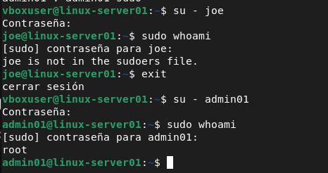

# User & Group Management

The server includes multiple users and groups to simulate a small organization.

### Example:

```
Users
│
├── Joe
├── bob
├── charlie
└── admin01

```

## Groups:

```
developers
support
sysadmins

```

## Tasks implemented:

- Create and remove users

- Create and manage groups

- Assign users to groups

- Configure user shells

- Manage passwords

- Configure sudo access

- Lock and unlock accounts

- Manage user permissions

### Example commands:

```
useradd
usermod
userdel
groupadd
passwd
chage
groups
id

```

## File Permissions & Ownership

The project implements Linux ownership and permission management.

### Example directory structure:

```

/opt/company/
│
├── developers/
├── support/
└── shared/

```
Permissions are configured according to the role of each group.

The project covers:

```

chmod
chown
chgrp
umask
getfacl
setfacl

```

The objective is to apply the principle of least privilege, ensuring that users only have access to the resources required for their role.


# Lab

step 1: creating and check the groups

```
sudo groupadd developers
sudo groupadd support
sudo groupadd sysadmins
```
```
sudo getent group developers
sudo getent group support
sudo getent group sysadmins
```
step 2: creating and check the users

```
sudo useradd -m -s /bin/bash joe
sudo useradd -m -s /bin/bash bob
sudo useradd -m -s /bin/bash charlie
```

• -m: Short for make home. It forces the system to automatically create a personal home directory for the user inside the /home/ path (for example: /home/joe). If you omit this parameter, the user account will be created, but they won't have a dedicated space to save their files.

• -s /bin/bash: Defines the default shell (the terminal environment) for the user. By specifying /bin/bash, you ensure that when they log in, they will have access to Bash, which is the standard, interactive console with auto-completion in Debian.

step 3: We assign passwords:

```
sudo passwd joe
sudo passwd bob
sudo passwd charlie
```

step 4: add users to groups

```
sudo usermod -aG developers joe
sudo usermod -aG developers bob
sudo usermod -aG support charlie
```

• -a: Stands for append. This is a crucial option because it tells the system to add the user to the new group while keeping them in all of their previous groups. (Warning! If you forget to include the -a, the user will be removed from all their current groups and will only belong to the new one).

• G: Specifies that you are working with secondary (or supplementary) groups. In Linux, a user has one primary group and can belong to multiple secondary groups to receive different permissions (such as accessing shared folders or using specific tools).

step 5: We checked that the users were added correctly

```
groups joe
groups bob
groups charlie
```

step 6: create an administrator

```
sudo useradd -m -s /bin/bash admin01
sudo passwd admin01
```

step 7: add administrator to sudo group

```
sudo usermod -aG sudo admin01
groups admin01
```
 test



