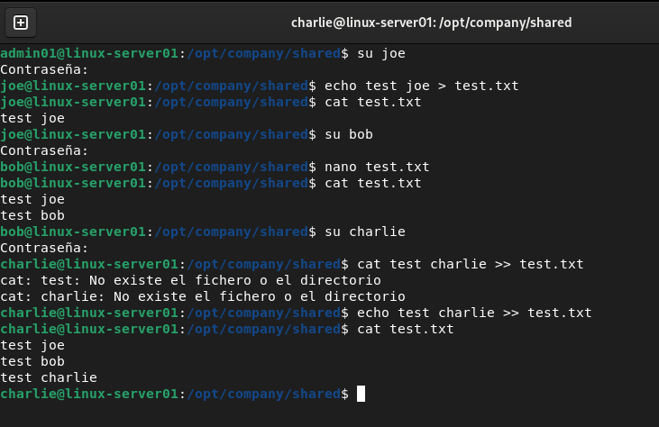

# Permissions

The project implements Linux ownership and permission management.

### Example directory structure:

```

/opt/company/
│
├── developers/
├── support/
└── shared/

```

Permissions are configured according to the role of each group.

### The project covers:

```

chmod
chown
chgrp
umask
getfacl
setfacl

```

The objective is to apply the principle of least privilege, ensuring that users only have access to the resources required for their role.

### shared path

```


                    /srv/company/shared
                            │
             ┌──────────────┴──────────────┐
             │                             │
        developers                       support
             │                             │
         joe / bob                      charlie
             │                             │
             └──────────────┬──────────────┘
                            │
                     Shared Files
```

# Lab

step 1: Creation of the company structure

```

/opt/company/
│
├── developers/
├── support/
└── shared/

```

```
sudo mkdir -p /opt/company/developers
sudo mkdir -p /opt/company/support
sudo mkdir -p /opt/company/shared

```

• -p: This stands for parents. It's an extremely useful option that does two things:

1. Creates the complete structure: If the /company folder doesn't exist within /opt, it creates it first, and then creates /developers inside it. Without the -p parameter, the command would fail, reporting that the directory doesn't exist.

2. Avoids errors: If the complete path or any of the folders already exist, it does nothing and doesn't display any error message.

step 2: we configure permissions

```
# Developers

sudo chown root:developers /opt/company/developers
sudo chmod 2770 /opt/company/developers
ls -ld /opt/company/developers

# Support
sudo chown root:support /opt/company/support
sudo chmod 2770 /opt/company/support
ls -ld /opt/company/support

```

• The 2 (Special Permission - SGID): Enables the SetGID (Set Group ID) bit. This is crucial for teamwork: any file or folder a user creates within this directory will automatically inherit the developers group, instead of the primary group of the user who created it. This ensures that all members of the group can always access what is stored there.

• The first 7 (Owner - root): Grants full read, write, and execute (rwx) permissions to the root user.

• The second 7 (Group - developers): Grants full read, write, and execute (rwx) permissions to all members of the developers group. They will be able to create, modify, and delete files.

• The 0 (Others): Completely blocks access to any user other than root and members of the developers group. They will not be able to see or enter the folder.

step 3: The development team needs to work together with the support team.
acl installation

```

sudo apt install acl

```

step 4: check it

```

getfacl /opt/company/shared

```

step 5: we create a group for the shared folder


```

sudo groupadd shared

# check

getent group shared

shared:x:1006:

```

step 6: add tems to shared group

```
sudo usermod -aG shared joe
sudo usermod -aG shared bob
sudo usermod -aG shared charlie

sudo usermod -aG shared admin01

# check

id joe

1001(developers),1008(shared)

```

step 7: change the owner group of shared

```
sudo chown root:shared /opt/company/shared

# check
ls -ld /srv/company/shared

```
step 8: configure base permissionss

```
sudo chmod 2770 /srv/company/shared

2 → setgid
7 → owner rwx
7 → group rwx
0 → others ---

```

step 9: configure acl

```
sudo setfacl -m g:shared:rwx /opt/company/shared

sudo setfacl -d -m g:shared:rwx /srv/company/shared


setfacl -m -> modifies the current directory ACL

setfacl -d -> configure a default ACL

```

step 10: ACL Check

```
getfacl /opt/company/shared

getfacl: Eliminando '/' inicial en nombres de ruta absolutos
# file: opt/company/shared
# owner: root
# group: shared
# flags: -s-
user::rwx
group::rwx
group:shared:rwx
mask::rwx
other::---
default:user::rwx
default:group::rwx
default:group:shared:rwx -> new items create here will inherit access to the shared group
default:mask::rwx
default:other::---

```

## Screenshoot

Now each member can work in their own folders, but they also have a shared folder where they can share files.


